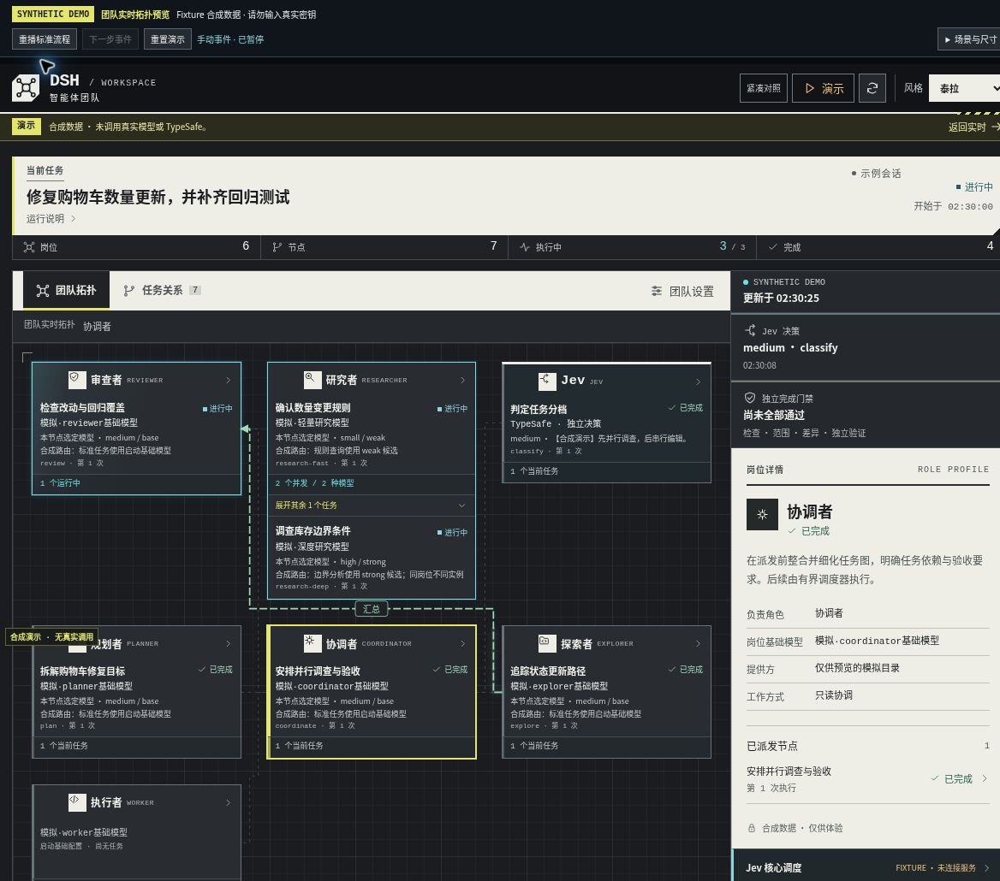

# 0.6.3-candidate.3：团队拓扑实时任务与关系事件

本候选从冻结的 candidate.2（2e48303973a5d4adbd9391574896da4fa736a73f）独立建立。candidate.2 的工具身份契约、官方 Todo 支持、同会话团队摘要和 system head 顺序修复完整保留。本轮范围是前端团队拓扑和离线预览，未新增模型请求、服务连接、预算或权限。

## 展示原则

- 默认进入团队拓扑；继续提供任务关系图、工作流/紧凑布局和泰拉/原版 UI。
- 每个岗位使用真实任务节点显示正在做的工作。多个并发节点各自保留 nodeId、状态、所选模型与路由原因，不能把全局最新选择套给所有岗位。
- 模型选择来自 production.routing.decisions 中该 nodeId 的记录。未报告选择时明确标注启动时基础配置，不宣称模型已被实际选用。
- 固定组织关系只是静态示意。瞬时覆盖层只呈现通过完整事件流序列检查和现有 edge 校验的新 relation_activated。
- 映射真实 fromNodeId/toNodeId 到岗位；没有组织示意边的真实关系直接连接正确端点。同岗位关系在本卡内呈现。宿主验证与 Jev 决策分别映射，不混成同一控制节点。
- 派发、依赖满足、反馈、重试、汇总采用独立文字和线型；“依赖满足”不等同消息传递。
- 动效仅在可见、未过期且活动运行中出现。终态、断连/过期和隐藏页面停止。减少动态效果设置下保留静态活动和事件含义。

## 不重播历史

首载、显式刷新、切换运行、隐藏页恢复和断线恢复只建立基线。事件按 runId + seq 消费；重复、乱序旧响应、缺失序列和日志截断不会补造或重播关系。兼容旧日志：没有关系激活事件时只保留静态关系并说明原因。

## 离线预览

preview/standalone.html 是单文件 HTML，不依赖 npm、服务或 API Key。页面持续标注合成演示；CSP 禁止网络连接。它仅用于界面和事件协议演示，不代表真实宿主、模型或 TypeSafe 调用。

预览提供场景/尺寸控制，用于检查并发不同模型、五类关系、Jev 与宿主验证映射、重复/乱序事件、运行切换、终态和断连。真实宿主由其自身生产数据提供这些记录，预览不会生成真实运行。

## 验证边界

最终 build、TypeScript 与 check:integration 通过：主套件 456 项，454 通过、0 失败、2 跳过；离线 evaluation 123/123，预检与三类离线 pilot/transport 全部通过。新增拓扑组件回归 18 项。

两项跳过沿用已知环境限制：未提供 PowerShell；临时目录处于上级 Git marker 下，无法构造真正的非仓库用例。跳过不等于通过。

官方 rc.2 工具契约 43/43，同会话 feedback-host、team-host、client-host 回归通过。工具契约使用 77 次确定性 fixture 模型请求、真实 read/glob 各 9 次，外部网络和付费模型调用均为 0。61 个受保护文件（包含全部 24 个后端 src 文件，以及 37 个运行、评估和客户端辅助文件）与冻结 candidate.2 逐字节相同。

云 Chromium 实际操作已覆盖全宽/420/320px、泰拉/原版 UI、同岗并发模型展开、五类关系、独立验证映射、重复/乱序/回退/切运行、断连恢复与五类终态。还在事件播放期间切换尺寸、主题和布局，确认端点精确落在重排后的源/目标卡片边界。所有尺寸无组件横向溢出。减少动效预览保留静态事件线和文字，停用扫描、呼吸与移动点。

隐藏页的真实浏览器验收保留限制：此云浏览器切后台或最小化仍报告 visibilityState=visible，不能将它计作真实隐藏事件验证。visibilitychange 的停止/恢复/不补播由组件回归覆盖。系统级 reduced-motion 媒体规则已检查，实际云浏览器验证使用预览的等价减少动效开关。

精确包、源码 commit 与 SHA-256 记录于交付清单。本候选未安装到用户电脑、未重启 DSH、未推送 GitHub，也不代替 Windows/Electron 或真实付费模型验收。
